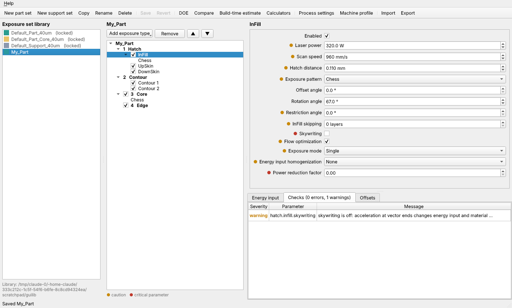

# LPBF Studio

Parameter-set editor for laser powder bed fusion (LPBF) build preparation, modelled on the
exposure-set concept of EOSPRINT 2.x's Parameter Editor. Version 0.1.0, first iteration.



## What it does

- **Exposure-set model.** An exposure set has a layer thickness and an ordered list of up to
  four exposure types. Part sets use Hatch, Core, Contour and Edge; support sets use Support.
  - **Hatch** has InFill, UpSkin and DownSkin. Parameters include stripe or chess pattern,
    offset, rotation and restriction angles, infill skipping, skywriting, flow optimization,
    double exposure, and time or power-reduction homogenization.
  - **Core** has skin thickness in x/y and z, open-to-platform, a base radius (quarter
    circle or Mattheck) and its own pattern.
  - **Contour** has 1 to 4 passes, each with its offset and in-skin, upskin and downskin
    power and speed, plus corridor and thickness detection.
  - **Edge** has an edge offset, Method 1 (edge factor and threshold) and Method 2
    (minimum radius factor).
- **Guard levels.** Every parameter is tagged free, caution or critical. The editor marks
  the latter two with an amber or red dot, mirroring the "caged switch" idea.
- **Locked reference sets.** These cannot be edited or deleted. You copy one to start a new
  set.
- **Live analysis** of the selected set:
  - Energy input per region: volumetric `P/(v·h·t)` for hatch and areal `P/(v·t)` for
    contours, edges and support.
  - Effective scan-line offsets, where GBO, PBO and the contour, hatch and edge offsets add
    up.
  - Rule checks. Examples: machine power and speed limits, layer-thickness range, an energy
    window, hatch distance against stripe width, skin thickness that is not a multiple of
    the layer thickness, positive ridge, skywriting off, a high power-reduction factor, and
    infill skipping without skins.
- **DOE generator.** Builds full-factorial variants of a set, for example a hatch-distance ×
  layer-thickness matrix, with a name template such as `HD_{hatch_distance_mm}`.
- **Compare** two sets parameter by parameter.
- **Build-time estimate** for a prismatic block. It also handles a z-segmented plan, for
  example thick layers at the bottom and fine layers on top, and is meant for comparing
  options.
- **Calculators.** Skin ridge for a maximum overhang angle, and the power-reduction curve
  `P(h) = P0 − r·P0·(1 − h/h0)`.
- **Process settings and machine profile** are stored in the library. They cover GBO,
  X/Y scaling, platform temperature, part or layer exposure order, dosing, and laser and
  scanner limits.
- **Import and export** as JSON (re-importable) or a CSV parameter table.

## Stack

Python 3.10+, pydantic v2 for the model and validation, click for the CLI, and PySide6
(Qt, LGPL) for the desktop GUI. The core library has no GUI dependency.

## Requirements

- Python 3.10 or newer
- pydantic 2.5+ and click 8.1+ (installed automatically)
- Optional: PySide6-Essentials 6.6+ for the desktop editor (`gui` extra), pytest 7+ for the
  tests (`dev` extra)

## Platform support

- Linux (local ext4 and tmpfs): supported and tested.
- macOS: not tested; no support claimed.
- Windows: the editor, the library and the format-1/format-2 models run and pass their tests
  (the GUI tests offscreen). The upgrade and reconcile paths need POSIX primitives
  (`fcntl.flock`, directory file descriptors, `O_NOFOLLOW`) and are refused on Windows with an
  explicit result rather than a partial write. The tests for those paths skip on Windows.
- Not supported or claimed: network file systems, FUSE mounts and cloud-synchronised
  folders. A folder that cannot be locked is refused.
- The upgrade lock is taken only by the upgrade and reconcile paths. Other editors, older
  LPBF Studio builds, sync tools and LPBF Studio's own ordinary saves (`Library.save`) do not
  take it, so a write made by any of them between the last re-check and the rename is lost.
  Upgrade a library only while nothing else writes to it, on a local file system.

## Install and run

```bash
git clone https://github.com/goforitseoul/LPBF-Studio.git
cd LPBF-Studio
python3 -m venv .venv && source .venv/bin/activate   # Windows: .venv\Scripts\activate
pip install -e ".[gui,dev]"

lpbf-studio          # desktop editor
lpbf --help          # command line
pytest               # core, CLI, library-safety and GUI offscreen tests
                     # (the POSIX upgrade and reconcile tests skip on Windows)
LPBF_REQUIRE_GUI_TESTS=1 pytest   # fail instead of skipping GUI tests when Qt cannot load
```

The library lives in `~/.lpbfstudio/library`. You can override this with `--library DIR`
or `LPBF_LIBRARY=DIR`. On first start it is seeded with three locked example sets.

### CLI examples

```bash
lpbf list
lpbf copy Default_Part_40um MyPart
lpbf rename MyPart MyPart_v2   # `lpbf set NAME name=...` is refused; use rename
lpbf rename MyPart_v2 MyPart
lpbf set MyPart hatch.infill.power_w=300 hatch.infill.homogenization=power_reduction hatch.infill.power_reduction_factor=0.2
lpbf energy MyPart
lpbf validate
lpbf doe MyPart -f hatch.infill.hatch_distance_mm=0.09:0.13:0.02 -f layer_thickness_mm=0.03,0.04 --name "HD_{hatch_distance_mm}_LT{layer_thickness_mm}"
lpbf compare Default_Part_40um MyPart
lpbf estimate --area 400 --perimeter 80 -s 0:16:Default_Part_40um -s 16:60:Default_Part_Core_40um
lpbf export MyPart MyPart.csv
lpbf machine list                      # profiles, consistency, how many sets use each
lpbf machine import my_machine.json
lpbf set MyPart "machine=My Machine"   # validate checks MyPart against this profile
```

Each set is validated against the machine profile named in its `machine` field. Profiles are
stored one per file in `<library>/machines/` (a 0.1.0 `machine.json` is still read and kept in
place). A blank, unknown or inconsistent reference is reported (`MRF-001`…`MRF-003`) and the
machine limits and energy window are then not checked; there is no fallback to another profile.

Parameter paths name the exposure type by kind (`hatch`, `core`, `contour`, `edge`,
`support`), so they stay valid when you reorder the exposure types. `lpbf show SET` lists
every path. In format 1 sets (all new sets) contour passes are addressed by position
(`contour.passes.0.power_w`), which changes when passes are removed or reordered. In format 2
sets each pass has a read-only id and paths use it (`contour.passes.@3f9c2e1a.power_w`); the
position form still works there, but output uses the id form, so filter by id. See
`docs/file_format.md`.

`lpbf doe` levels are a list (`0.09,0.11,0.13`; spaces and semicolons also separate numbers,
text levels are separated by commas or semicolons only) or an inclusive range
`start:stop:step`. A range must end exactly at `stop`, integer parameters need whole numbers,
and levels must be distinct. The command prints the variant count first and refuses designs
above 500 variants unless `--max-variants` is raised. Before saving it checks every variant
name (taken, sharing a file, or a file name the file system cannot hold) and saves nothing if
any fails; `--dry-run` runs the same checks. A probable decimal comma such as `0,05` is refused;
write `0.05`. Names keep the 6-digit form (`HD_0.09`) and switch to the exact value only when
6 digits would round it.

`--dry-run` also lists each factor's levels as they were parsed, for example
`hatch.infill.power_w: 285, 5`. Check this line: a decimal comma with a fraction that does not
start with 0 (`285,5`) cannot be told apart from two levels and is read as 285 and 5.

**Saving a DOE is not transactional.** Variants are saved one by one. If saving fails or is
interrupted with Ctrl+C part-way (disk full, no permission, a name taken meanwhile by another
program), the variants saved before that stay in the library. The command then checks the
library and lists the variants saved, failed, uncertain (state could not be verified) and not
attempted, and exits with status 1 after an error or 130 after Ctrl+C. Delete or keep the saved
ones yourself. A killed process or a power loss gives no report. The rules and the defects they
fix are in [docs/doe_audit.md](docs/doe_audit.md).

`lpbf set` applies all assignments or none: if one is invalid, the set is left unchanged.
`lpbf validate` prints each finding as `[SEVERITY] CODE path: message`; the codes and the
path conventions are listed in [docs/validation_rules.md](docs/validation_rules.md).

## Layout

```
src/lpbfstudio/
  models.py      exposure-set / process / machine model with UI metadata
  calc.py        energy input, power reduction, ridge, hatch angles, offsets
  validation.py  rule checks with stable codes (docs/validation_rules.md)
  paths.py       dotted parameter paths, flatten, diff
  doe.py         DOE variant generator
  estimate.py    build-time comparison estimate
  library.py     folder-backed set library (one JSON per set)
  defaults.py    locked example sets
  migration.py, upgrade.py           schema versions and file upgrades
  reconcile.py, reconcile_apply.py,
  restore_record.py                  recovery after interrupted upgrades (docs/reconciliation.md)
  cli.py         `lpbf` command
  gui/           PySide6 editor (forms generated from model metadata)
tests/           pytest suite
docs/            specifications and design notes
```

Some docs and code comments refer to internal review records under `docs/audit/` or to design
notes under `plans/`. Those are kept private and are not part of this repository.

## Important notes

- The shipped sets hold **illustrative values only**. They are not qualified material
  parameters.
- This is an independent tool. It does not read or write any vendor's job or task files,
  and it is not affiliated with EOS. Interoperability with machine formats is a later step
  (see the roadmap).
- The build-time estimate leaves out jumps, delays and skywriting time. Use it to compare
  options.
- With infill skipping (`skip_layers` = n > 0, infill exposed every (n+1)-th layer), the energy
  table keeps the nominal value P/(v·h·t) and adds a separately labelled **idealized layer-cycle
  average energy density** E_eff = P/(v·h·(n+1)·t), and validation reports it as `ENG-003`. E_eff
  is a periodic-cycle idealization: it is not a prediction of melt-pool behaviour, fusion, density
  or part quality, and not the exact average of a particular part (short regions can differ by up
  to n/N, where N is the number of layers). It is unavailable for double exposure, power-reduction
  homogenization and pattern "none". The energy-window checks still use the nominal value. Details:
  [docs/calc_spec_infill_skipping.md](docs/calc_spec_infill_skipping.md).
- The contour corridor angle is an approximation inferred from the corridor and thickness
  geometry.
- Each set is stored as `sets/<name>.json`, with characters other than letters, digits and
  `_ . + -` replaced by `_`. Names that would share a file (for example `My Part` and `My_Part`)
  are refused with an error instead of overwriting each other. Files are written atomically.
  Unreadable or duplicate set files are skipped and reported (`lpbf list` prints a warning; the
  editor shows them in the status bar); they are never modified or deleted.
- Set files carry `schema_version`. Formats 1 and 2 are supported; a file without the key is read
  as version 1, and any other value (a newer version such as 99, or an invalid value) is refused
  with its reason and left untouched. `lpbf validate` with no names exits 1 when any set file could
  not be loaded. Format 2 gives each contour pass a read-only id, so a pass can be named
  `contour.passes.@<id>.power_w` and keeps that name when passes are reordered. New sets are
  format 1 and every set keeps its format; there is no upgrade command yet. Details:
  [docs/file_format.md](docs/file_format.md).

## Roadmap (suggested next iterations)

1. Geometry pipeline: STL import, slicing, and hatch/contour vector generation using the set
   parameters. It would come with a 2D layer preview coloured by region (infill, upskin,
   downskin, contour, edge) and by exposure order.
2. Job model: parts on a platform, assigning a set per part or z-segment, part-specific beam
   offset, exposure sorting against gas flow, and recoater-aware placement checks.
3. Export to an open layer format (CLI/SLI-style vectors) and per-machine adapters.
4. Material-specific energy windows and parameter templates. Audit trail and
   signed/approved sets for production use.
5. Packaging: a PyInstaller or Briefcase installer, licence-key check, and auto-update.

## License

Copyright (c) 2026 goforitseoul. All rights reserved. This source code is published for
reference only; no licence is granted to use, copy, modify, merge, publish, distribute,
sublicense, or sell copies of the software. See [LICENSE](LICENSE).
